# Emberwake UI review

**Reviewed:** 2026-10-11, before the UI-token pass. Screenshots in [`before/`](before/).
**Method:** Nielsen's 10 heuristics and WCAG 2.2 AA. No hallmark UX-review skill or mode is installed in this environment, so those two are the bar.
**How it was looked at:** headless Chrome at 1× against the Vite dev server. Viewports: 1280×720, 360×740, 412×915, and a short landscape phone at 740×360. Phone viewports emulate a coarse pointer so the touch HUD (flare button, 48px menu buttons) is the one a phone actually gets. `env(safe-area-inset-*)` stayed 0; Chrome will not invent a notch, so safe-area is reviewed from the CSS, not from a device cutout.

Save used for the main set: 1,243 cinders, only Kael and the Gloam unlocked, no Heat, no Keepsake. A second 412×915 pass (`select-rich.webp`, `hearth-rich.webp`) turns Heat, a Dawn Seal keepsake, and the Eternal Embers on, still with 1,243 cinders, so unaffordable prices and the keepsake chips are on screen.

## Top findings

1. **The cinder balance is clipped or off-screen on the screen where you spend it.** On Bearer select the action row is `position: sticky` with a negative bottom margin, and the wallet is the next sibling, so the row paints over the balance. At 412×915 the row (y 800–872) covers the wallet (y 864–885). With Heat and a keepsake on, the wallet falls past the panel edge entirely (y 895–916, panel ends at 899). At 360×740 and 740×360 the wallet sits below the viewport until you scroll, and the sticky row is waiting there. The Hearth wallet is the last element of a long grid (y ≈ 2000 on a 915px phone). You shop without knowing what you hold.
2. **Prices you cannot pay look the same as prices you can, and a refused tap only plays a sound.** At 1,243 cinders, Twin Flame (4,500) and Second Wick (2,000) use the same ember price as Kindled Strength (60). Hearth cards are not buttons, have no `aria-disabled`, and the click handler calls `sfx.deny()` and returns. Bearer unlock does set `disabled`, which removes it from keyboard and gamepad navigation and gives no reason.
3. **Chrome does not share a radius, border, shadow, or focus treatment.** Computed radii on one screen include 2, 3, 4, 5, 6, 7, 8, 9, 10, 12, 14, and 16px, plus 50%. Cards are 12px, buttons 10px, the info box 8px, the panel 16px, heat chips 8px, seals 14px. Glows are one-off blurs. Keyboard focus is a 3px ember outline; gamepad focus adds a second glow with `!important`.
4. **The stage card's thumbnail does not read, the card is hollow, and the carousel does not say it scrolls.** The swatch is the stage ground (`#141a24` on the Gloam) plus two low-alpha blobs, so it is a dark square. On phones the strip is a row of 236×220 cards (`align-items: stretch`), so a short card grows to the tallest neighbour and the 54px swatch sits in the top of an empty left column. The next card is cut off (`scrollWidth` about 1,600px past the client) with no fade, label, or scrollbar.
5. **Short landscape hides the title menu.** At 740×360 the logo, tagline, lineup, and five 48px touch buttons do not fit, and `#screen` does not scroll (`body` is `overflow: hidden`). Settings and the Hearth sit below the fold with no way to reach them.
6. **Several controls are under 44×44px, and two text styles are under the 11px floor in the art guide.** Measured: pause 38×38 (desktop), Heat and keepsake chips 32×32 (keepsake names such as "Moss Charm" are clipped to that square), Dawn 65×22, difficulty segments about 39px tall, level-up ghost buttons 34px tall on desktop, checkboxes 20×20 (the row is the real target and is about 42px). Flare name on the touch button is 8px, the Space kbd is 9px, slot levels and the Kindle "next" line are 10px, the daily "free trial" chip is 10px.

## Screens

### Title

Hierarchy is clear: Cinzel wordmark, tagline, lineup, one primary action, then Hearth with the balance in the button. That is the right place for a balance you are about to spend, and it is visible at 1280×720 and on both phones.

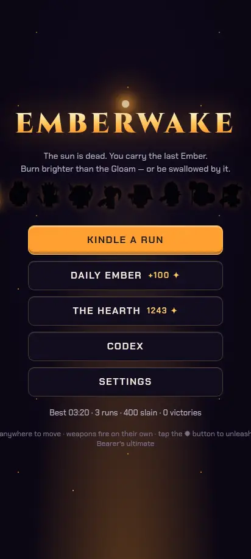

The wordmark is `background-clip: text` with `color: transparent`. A contrast probe reports ~1:1 because it samples the transparent color, not the gradient. The gradient runs Ember Core to Ember Deep on near-ink, which is the brand, and it stays. The tagline uses Slate Highlight (`--muted`) and clears 4.5:1 on ink.

At 740×360 the menu is clipped (finding 5). Safe-area padding is already on `#screen`; it cannot help a block that is taller than the viewport and cannot scroll.

### Bearer and stage select

This is the reported screen. Desktop lays Bearers and stages out as grids and is readable, but the wallet is below the panel (y 1336 vs a panel that ends at 704), so the balance is off-screen until you scroll into the sticky row.

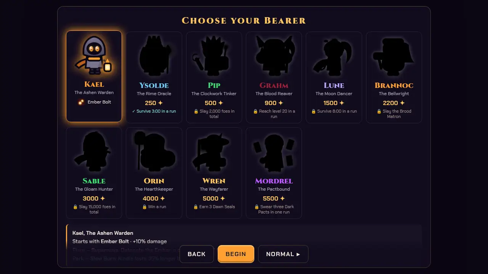

Phones turn both grids into horizontal scroll-snaps. The Bearer strip gives no hint either, but several faces are on screen, so the cut-off is less severe than the stage strip, which shows one card and a sliver.

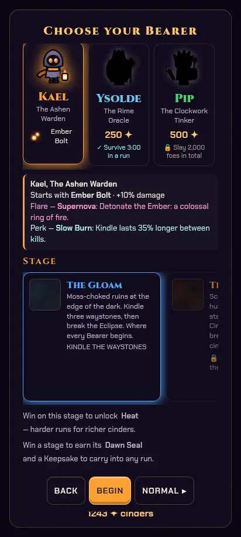

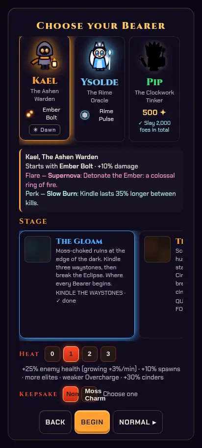

Spacing between the heading, the detail box, the stage label, the locked-Heat note, and the buttons is a mix of 8, 10, 14, 16, and 18px margins, which is why the blocks feel uneven. The detail box is a left border and an 8px radius; the stage card is 12px; the panel is 16px.

Locked stages already say why (`🔒 …`). Tapping one only plays the deny sound. Heat chips at 32px fail the touch target and, once keepsakes appear, clip the name.

### HUD

Desktop at 1280×720 reads in the right order: XP, weapons, timer, objective, Kindle, flare. Pause is 38px, under the 44px target. Slot levels are 10px.

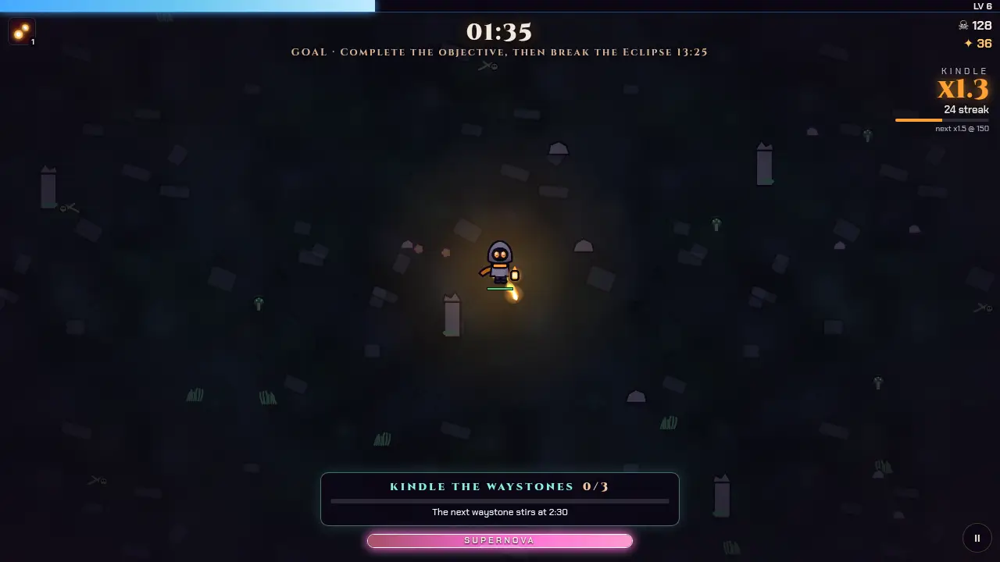

On a phone the pause control grows to 46px and the flare button is 88px, which is fine. The flare's name is 8px. In short landscape the objective pill, the flare button, and pause share the bottom band, and the goal line, timer, and Kindle share the top. They collide.

Safe area is applied to the XP bar, top bar, Kindle, flare, objective, and pause (`--sat` / `--sab` / `--sal` / `--sar`). That part is in good shape; the collision is the portrait-to-landscape layout, not the inset.

### Level-up

Three choices, a numbered key, a clear primary line, and a stat line. The panel scrolls, so a short phone can reach Skip. Desktop ghost buttons are 34px tall. Reroll/Banish use `disabled` and `opacity: 0.35`, which drops the label under 4.5:1. Pact and fusion borders are semantic and should stay colored; they should use the same radius and glow size as other cards.

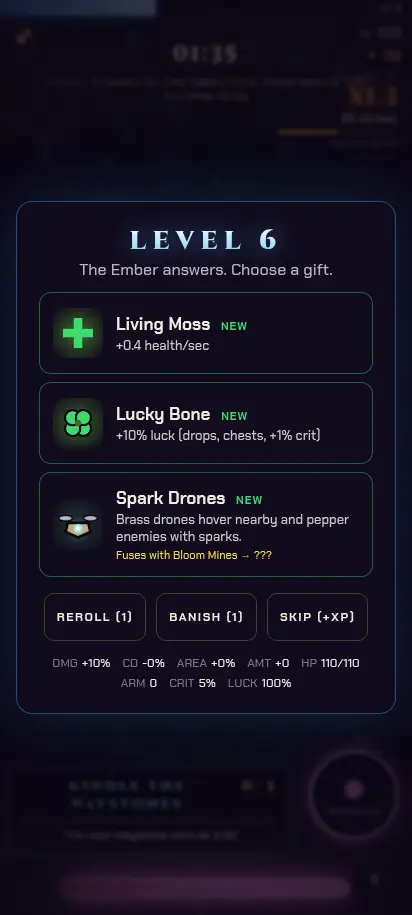

### Chest

The build-up and the opened reels read as a reward. The panel is `overflow: hidden`, so on a short landscape phone the claim button can sit on the bottom edge of the viewport. Radius on the reel (14px) matches nothing else.

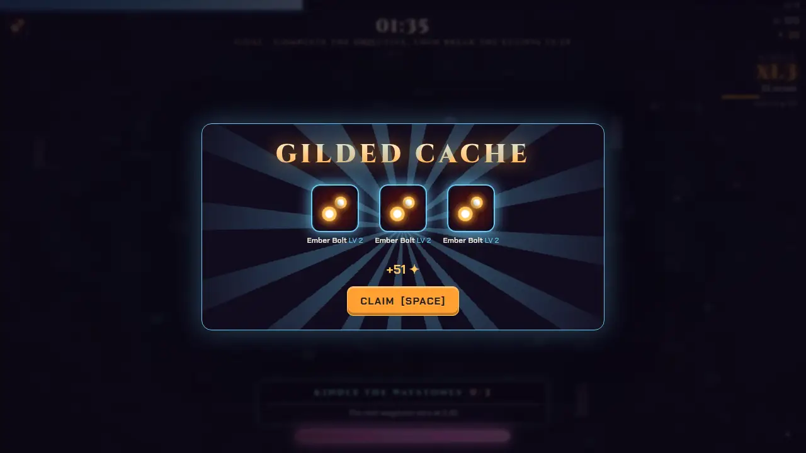

### Pause

Run context, weapon table, stats, Resume / Settings / Abandon. Abandon is a ghost danger button, which is the right weight. Nothing is spent here. On short landscape the panel scrolls inside `max-height: calc(100dvh - 32px)`.

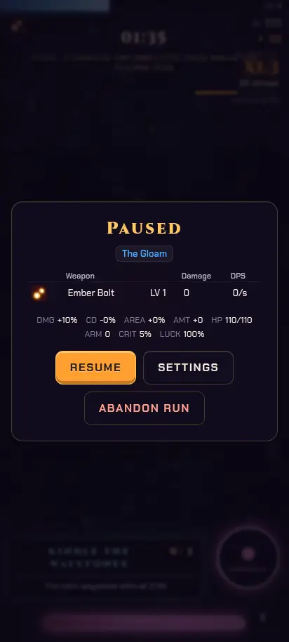

### Hearth

The shop. Every upgrade is a card with the same ember price, whether or not 1,243 cinders covers it. The balance is past the end of the grid on every viewport measured. Eternal Embers, once a win has lit them, are the same pattern with larger prices. There is no pressed, disabled, or "not enough" state other than the card dimming at max rank.

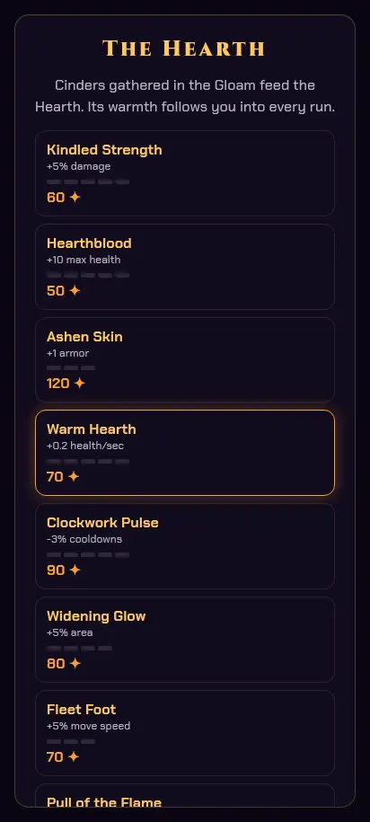

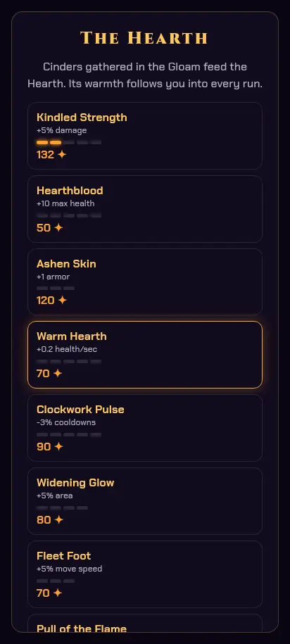

### Codex

A long reference: ascensions, feats, seals, records, bestiary, weapons, relics, rules. It does not spend cinders. Feats and seals do show cinder rewards, and the user asked for the balance on this screen because it is where you check what a run is worth. It is not shown. Tables scroll with the panel. Locked relics are dimmed and say why, which is the pattern the shop should follow.

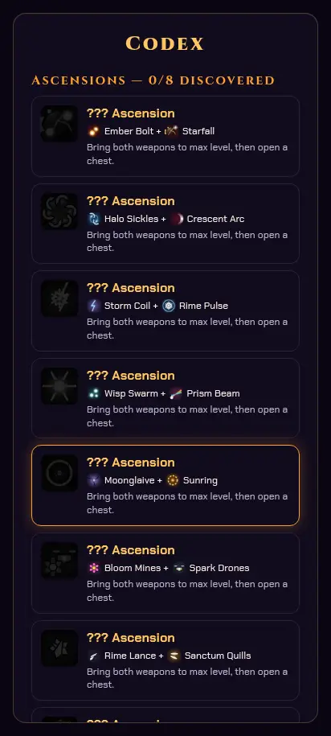

### Results

The outcome, the breakdown, and Again / Share / The Hearth / Title. The earned line shows what this run paid. It does not show the balance you now hold, which is the number that decides whether the Hearth is worth opening. On a 360px-wide phone the summary is long; the actions sit at the end of the scroll.

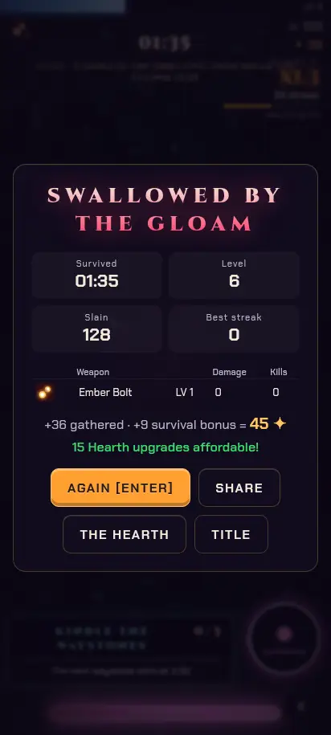

### Settings

Difficulty is a segment control at about 39px tall. Toggles are close to 44px on the label and 20px on the checkbox itself. Sliders are native and thin; the row should carry the hit area. Erase save is a danger ghost and asks `confirm()`, which is the right friction. No currency.

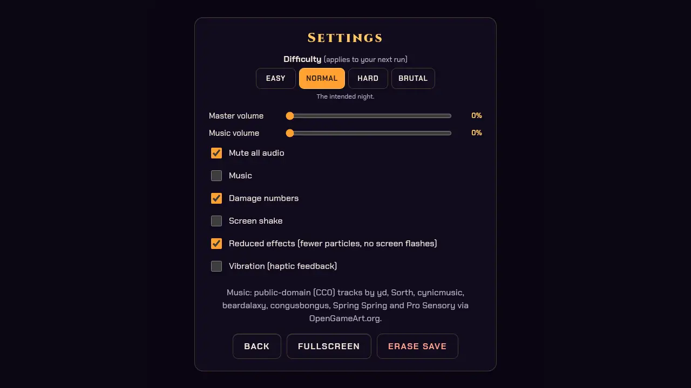

### Daily Ember

Fixed setup, a free-trial chip at 10px, and the +100 cinder promise in the record line. No spend. Fine at every viewport except the short landscape, where it depends on the panel scroll (it has one).

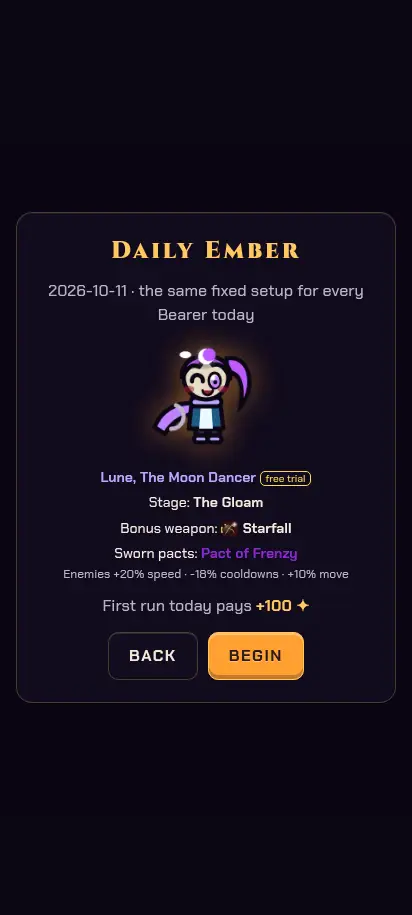

## Heuristics

| Heuristic | What showed up |
|---|---|
| Visibility of status | Balance missing or clipped on select, Hearth, Codex, results. Kindle, flare, and the objective are in good shape during a run. |
| Match to the real world | Ember for "you can buy", but the same ember is used when you cannot. |
| User control | Sticky actions are right; they must not cover the balance. Title landscape has no scroll. |
| Consistency | 13 radii, mixed borders and glows, two focus treatments. |
| Error prevention | Unaffordable cards still look pressable. |
| Recognition | Stage thumbnail does not depict the stage. Keepsake names are clipped. |
| Flexibility | Keyboard, gamepad, and touch all exist. `disabled` drops a purchase out of gamepad nav, so you cannot land on it and learn why. |
| Aesthetic and minimalist | The hollow stage card and the uneven select stack add space that does not group anything. |
| Error recovery | A denied purchase has no text. Sound is not enough (and mute exists). |
| Help | Locked stages and relics already explain the requirement. Prices do not. |

## WCAG 2.2 AA

| Check | Result |
|---|---|
| 1.4.3 Contrast (text ≥ 4.5:1) | Body text on panel is Text `#f3e9dc` at about 16:1. Muted Slate Highlight `#b8b4c8` is about 9.5:1. Ember `#ffa030` and Ember Light `#ffc860` pass on the panel. Slate Light `#7a7490` is 4.31:1 on the panel and 4.50:1 on ink, so it is only safe on ink. `opacity: 0.35` on disabled buttons fails. Hostile Signal `#ff3a6a` is 5.53:1 on the panel, so it can carry a "can't afford" price. |
| 1.4.4 Resize | `maximum-scale=1` and `user-scalable=no` block pinch zoom. Left as-is: it is a game viewport, and changing it is outside this pass. |
| 1.4.11 Non-text contrast | Panel border is Ember Light at 25% on the panel, which is decorative. Selected cards use the Bearer or stage color. |
| 2.4.7 Focus visible | `:focus-visible` is present on buttons and cards. Gamepad uses a second ring. |
| 2.5.5 Target size (AAA, asked for here) | 44px is the bar this pass was given. Pause, Heat, keepsakes, Dawn, difficulty segments, and desktop level-up ghosts miss it. |
| 2.5.8 Target size minimum (24px, AA) | Heat at 32px passes AA and fails the 44px bar. Dawn at 22px fails AA as well. |
| 4.1.2 Name, role, value | Purchase cards are `div`s with a click handler. No role, no name for the disabled reason, no `aria-disabled`. |

## What this pass will change, and what it will leave

Change: one token set (radius 6 / 10 / 16 / pill, two border widths, two elevations, two glows, a 4–24 spacing scale, one focus ring) applied across the chrome; the wallet moved into the sticky action dock on select and a sticky bar on every screen where you decide to spend (Hearth, Codex, results, and the select dock that already holds Heat and keepsakes); a can't-afford price in Hostile Signal, a lock, `aria-disabled` plus a visible reason, and no silent tap; affordable cards drawn as actionable; stage thumbnail uses that stage's landmark sprite on its ground color; stage cards shrink to their text; a scroll fade and a "swipe" hint; 44px targets on the controls listed above; the 11px text floor; title and HUD repaired for short landscape.

Leave: combat, drops, prices, unlock requirements, and balance. The wordmark gradient. Chest and level-up motion. Pinch-zoom lock. A real-device notch check (the insets are already wired). Rewriting the HUD into a new layout on desktop, where it already reads.

## Screenshot index

Every screen, before any of the changes above.

The checked-in set is 1280×720 and 412×915. The 360×740 and 740×360 passes were reviewed the same way and are not stored here.

| Screen | 1280×720 | 412×915 |
|---|---|---|
| Title | [desktop](before/desktop-1280x720/title.webp) | [412](before/phone-412x915/title.webp) |
| Select | [desktop](before/desktop-1280x720/select.webp) | [412](before/phone-412x915/select.webp) |
| Hearth | [desktop](before/desktop-1280x720/hearth.webp) | [412](before/phone-412x915/hearth.webp) |
| Codex | [desktop](before/desktop-1280x720/codex.webp) | [412](before/phone-412x915/codex.webp) |
| Settings | [desktop](before/desktop-1280x720/settings.webp) | [412](before/phone-412x915/settings.webp) |
| Daily | [desktop](before/desktop-1280x720/daily.webp) | [412](before/phone-412x915/daily.webp) |
| HUD | [desktop](before/desktop-1280x720/hud.webp) | [412](before/phone-412x915/hud.webp) |
| Level-up | [desktop](before/desktop-1280x720/levelup.webp) | [412](before/phone-412x915/levelup.webp) |
| Chest | [desktop](before/desktop-1280x720/chest.webp) | [412](before/phone-412x915/chest.webp) |
| Pause | [desktop](before/desktop-1280x720/pause.webp) | [412](before/phone-412x915/pause.webp) |
| Results | [desktop](before/desktop-1280x720/results.webp) | [412](before/phone-412x915/results.webp) |

Also at 412×915: [select with Heat and a keepsake](before/phone-412x915/select-rich.webp), [Hearth with Eternal Embers](before/phone-412x915/hearth-rich.webp).
